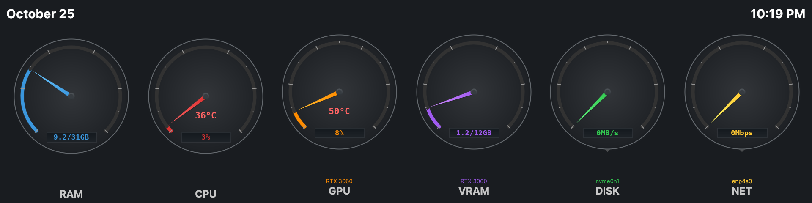
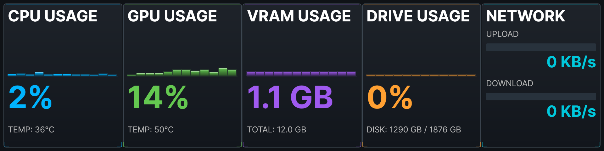

# System Monitor for Linux

**The Linux version of Memory Monitor, built with .NET 8 and Avalonia UI**


This is a separate project from the Windows version in `Memory Monitor/`. It shares a few platform-neutral
files with it, but building the Linux version never touches the Windows project, solution or installer.

---

## 📸 Screenshots


*Circular gauges mode on a 1920x480 mini display (Ubuntu 24.04, RTX 3060)*


*Bar graph mode*

---

## Features

- **Automatic move to any 1920x480 display** - fills the first very wide (4:1) screen it finds
- **Two display modes** - Circular Gauges and Bar Graph, switchable from the right-click or tray menu
- **CPU** - usage and temperature
- **GPU** - usage, temperature and VRAM for NVIDIA and AMD
- **RAM, Disk and Network** - with auto-scaling for disk and network throughput
- **Game FPS** - from MangoHud, shown only while a game is running
- **Date and time** on the mini display
- **System tray icon** - live memory gauge with the same menu as Windows; Escape hides to the tray
- **Device selection** - click the DISK or NET gauge (or GPU/VRAM with several GPUs) to pick a device
- **Remembers your settings** - display mode, always on top, FPS and chosen devices
- **Splash screen and intro logo** on startup

### What isn't ported yet

| Windows feature | Linux status |
|-----------------|--------------|
| Touch gestures | Not yet |
| Welcome dialog on first run | Not yet |
| Fade animation when switching display modes | Not yet |

---

## Requirements

### To run
- **Linux x64** desktop. Tested on **Ubuntu 24.04 with GNOME on X11** and an NVIDIA RTX 3060.
  Other distributions and Wayland sessions should work but haven't been tested.
- **System tray** (optional) - a StatusNotifierItem host. Ubuntu's *AppIndicator* extension (enabled by
  default on Ubuntu) and KDE provide one; plain GNOME needs the
  [AppIndicator extension](https://extensions.gnome.org/extension/615/appindicator-support/).
  Without a tray, Escape exits instead of hiding.

### For GPU monitoring
- **NVIDIA** - the proprietary driver (provides `libnvidia-ml.so.1`). Check with `nvidia-smi`.
  On Ubuntu: `sudo ubuntu-drivers autoinstall`.
- **AMD** - the open-source `amdgpu` driver, usually already installed. If readings are missing,
  add yourself to the video group: `sudo usermod -a -G video $USER`, then log out and back in.
- **Intel graphics** - not supported.

### For CPU temperature
Read from the kernel's thermal zones (`x86_pkg_temp`, `coretemp` or `cpu`). This works on Intel CPUs.
Many AMD CPUs don't expose one of these zones, so the temperature won't show.

### To build from source
- **.NET 8 SDK** - on Ubuntu: `sudo apt install dotnet-sdk-8.0`

The release package doesn't need .NET; it includes its own runtime. No other packages are needed.

---

## Installing

1. Download `memory-monitor-<version>-linux-x64.tar.gz` from
   [Releases](https://github.com/rickbme/Memory-Monitor/releases) (or build it, see below).
2. Unpack it and run the installer:
   ```bash
   tar -xzf memory-monitor-2.4.4-linux-x64.tar.gz
   cd memory-monitor-2.4.4-linux-x64
   ./install.sh
   ```
3. Start **Memory Monitor** from the app menu, or run `memory-monitor`.

The installer is for your user only and doesn't need sudo. It asks whether to:
- **start Memory Monitor at login**
- **add a desktop shortcut**
- **set up MangoHud** for game FPS (only if you don't already have a MangoHud config)

Use `./install.sh --yes` or `./install.sh --no` to answer all of these at once. Running a newer
`install.sh` upgrades an existing install; exit Memory Monitor first.

### What gets installed

| Path | What |
|------|------|
| `~/.local/share/memory-monitor/` | The app, this README and `uninstall.sh` |
| `~/.local/bin/memory-monitor` | Launcher command |
| `~/.local/share/applications/memory-monitor.desktop` | App menu entry |
| `~/.local/share/icons/hicolor/*/apps/memory-monitor.*` | Icons |
| `~/.config/autostart/memory-monitor.desktop` | Start at login (optional) |
| `~/.config/memory-monitor/settings.json` | Your settings (created by the app) |
| `~/.local/state/memory-monitor/` | Log file and crash dumps (created by the launcher) |

### Uninstalling

```bash
~/.local/share/memory-monitor/uninstall.sh
```

It removes everything above and asks before deleting your settings and logs. MangoHud's config and game
logs are left alone.

---

## Building from Source

```bash
git clone https://github.com/rickbme/Memory-Monitor.git
cd Memory-Monitor
git checkout linux-port
cd MemoryMonitor.Linux

# Build and run (like Ctrl+F5 in Visual Studio)
dotnet run
```

### Release package

```bash
./package-linux.sh
```

This publishes a self-contained build and creates `bin/dist/memory-monitor-<version>-linux-x64.tar.gz`
with the app, icons, `install.sh`, `uninstall.sh` and this README. The version comes from `<Version>` in
`MemoryMonitor.Linux.csproj`.

### Developing in VS Code
- Install **C# Dev Kit** for F5 debugging and breakpoints.
- Install **Avalonia for VSCode** (by AvaloniaTeam) for `.axaml` editing and a live preview.
  The extension's current previewer expects Avalonia 12; this project uses Avalonia 11, so add this to
  `.vscode/settings.json` or the preview won't start:
  ```json
  "avalonia.preview.useLegacyPreviewer": true
  ```

---

## Using It

| Action | How |
|--------|-----|
| Switch display mode | Right-click → **Display Mode**, or tray icon → **Display Mode** |
| Choose disk / network / GPU | Click the gauge (shown by the small arrow under it) |
| Move the window | Drag the background |
| Move to the next monitor | Right-click → **Move to Next Monitor** |
| Always on top | Right-click → **Always on Top**, or **F11** |
| Hide to tray | **Escape** (tray icon → **Show** brings it back) |
| Turn game FPS on/off | Right-click → **Show Game FPS (MangoHud)** |
| Exit | Right-click or tray icon → **Exit** |

### Settings

Settings are saved in `~/.config/memory-monitor/settings.json`. Delete the file to go back to the defaults.

---

## 🎮 Game FPS with MangoHud

Windows reads FPS from HWiNFO and RTSS. On Linux, Memory Monitor reads it from
[MangoHud](https://github.com/flightlessmango/MangoHud)'s log files. With logging on, MangoHud writes the
game's FPS to a CSV file every half second, and Memory Monitor shows the newest value.

The FPS badge appears between the GPU and VRAM gauges (or as **FPS: N** on the GPU panel in bar graph
mode) while a game is running, and disappears a few seconds after it closes.

| Color | FPS |
|-------|-----|
| 🟢 Green | 60 and above |
| 🟡 Yellow-green | 45-59 |
| 🟠 Orange | 30-44 |
| 🔴 Red | Below 30 |

### Setup

**1. Install MangoHud.** The Steam snap already includes it. Otherwise: `sudo apt install mangohud`.

**2. Create a MangoHud config** that logs to the folder Memory Monitor watches.

If Steam is installed as a **snap**, the config goes in the snap's home folder,
`~/snap/steam/common/.config/MangoHud/MangoHud.conf`:

```ini
# Log FPS automatically so Memory Monitor can show it (games launched with: mangohud %command%)
output_folder=/home/YOUR_USER/snap/steam/common/mangohud-logs
autostart_log=1
log_interval=500
```

Otherwise use `~/.config/MangoHud/MangoHud.conf` with
`output_folder=/home/YOUR_USER/mangohud-logs`.

Create the log folder too (`mkdir -p` the path above). Replace `YOUR_USER` with your user name.

**3. Add MangoHud to each game.** In Steam, right-click the game → **Properties** → **Launch Options**:

```
mangohud %command%
```

### Notes
- **The MangoHud overlay appears in the game.** It can't be hidden completely, because MangoHud stops
  logging when its display is turned off (`no_display`). Add `fps_only` to the config for a minimal overlay.
- **Older 32-bit games may not start with MangoHud.** If the game offers a 64-bit version, use that
  (this was needed for *Rise of the Triad*).
- **MangoHud works with more than Steam** - any Vulkan or OpenGL program started as `mangohud <program>`.
  Normal desktop apps don't report FPS, on Linux or Windows.
- **Logs older than 7 days are deleted** from the log folder each time Memory Monitor starts.

---

## Differences from the Windows Version

- **Drive Usage capacity** in bar graph mode shows the root filesystem (`/`). Windows shows the first fixed drive.
- **No HWiNFO, LibreHardwareMonitor or RTSS.** Linux reads hardware data directly from `/proc` and `/sys`,
  NVIDIA's NVML library and MangoHud.
- **The disk and network gauges show one device at a time.** Windows also has an "All Disks" / "All Networks" total.
- **Right-click menu.** Linux adds a right-click menu on the window as well as the tray menu.

---

## Troubleshooting

### The tray icon doesn't show
- Make sure a tray host is running (see [Requirements](#to-run)). On Ubuntu, check that the
  *Ubuntu AppIndicators* extension is enabled in the Extensions app.
- Escape exits instead of hiding when Memory Monitor can't find its tray icon, so you can't get stuck
  with a hidden window.

### No CPU temperature
Your CPU doesn't expose a supported thermal zone. List them with:

```bash
for z in /sys/class/thermal/thermal_zone*; do echo "$(cat $z/type) $(cat $z/temp)"; done
```

### No GPU readings
- NVIDIA: run `nvidia-smi`. If it fails, the proprietary driver isn't installed.
- AMD: check `cat /sys/class/drm/card*/device/vendor` shows `0x1002`.

### No FPS badge while gaming
- Is the MangoHud overlay showing in the game? If not, the launch option isn't set.
- Are `.csv` files appearing in the log folder while the game runs? If not, check `output_folder` and
  that the folder exists.
- Is **Show Game FPS (MangoHud)** checked in the right-click menu?

### The window appears on the wrong screen
Memory Monitor picks the first screen with a 4:1 (or wider) shape, then any secondary screen, then the
main one. Use **Move to Next Monitor** to move it.

---

## Known Issues

- **Rare crash on startup.** In testing, about 1 in 100 launches crashed within the first few seconds.
  The cause isn't known yet. Start it again if it happens. When started from the app menu or
  `memory-monitor`, a crash dump is saved in `~/.local/state/memory-monitor/crash-dumps/`; please attach
  it, with `memory-monitor.log` from the same folder, to an [Issue](https://github.com/rickbme/Memory-Monitor/issues).
- **Tray tooltip.** Avalonia 11's Linux tray code copies the tooltip text into the icon's status, so the
  tooltip has to be the word "Active" for Ubuntu to show the icon. GNOME doesn't display tray tooltips,
  so this isn't visible.

---

## Project Structure

```
MemoryMonitor.Linux/
├── MemoryMonitor.Linux.csproj    # Linux project (links shared files from ../Memory Monitor/)
├── Program.cs                    # Entry point
├── App.axaml(.cs)                # Starts the splash screen, then the main window
├── SplashScreen.cs               # Startup splash with the round DFS logo
├── AppSettings.cs                # Settings in ~/.config/memory-monitor/settings.json
├── MainWindow.axaml              # Layout: gauge view, bar graph view, intro logo, right-click menu
├── MainWindow.axaml.cs           # Startup, window placement, display mode, menus
├── MainWindow.Gauges.cs          # Circular gauge updates and device selection
├── MainWindow.BarGraph.cs        # Bar graph panel updates
├── MainWindow.Tray.cs            # System tray icon and menu
├── Controls/
│   ├── GaugeControl.cs           # Circular needle gauge
│   ├── FpsGaugeControl.cs        # Round FPS badge
│   ├── BarGraphPanelControl.cs   # CPU / GPU / VRAM / Drive panels
│   ├── NetworkBarPanelControl.cs # Upload / download panel
│   ├── PanelDrawing.cs           # Shared drawing for the bar panels
│   └── GaugeIconGenerator.cs     # Live tray icons
├── Monitors/
│   ├── LinuxCPUMonitor.cs        # /proc/stat and thermal zones
│   ├── LinuxMemoryMonitor.cs     # /proc/meminfo
│   ├── LinuxGPUMonitor.cs        # NVIDIA (NVML) and AMD (sysfs)
│   ├── LinuxNVMLInterop.cs       # libnvidia-ml.so.1 bindings
│   ├── LinuxDiskMonitor.cs       # /proc/diskstats
│   ├── LinuxNetworkMonitor.cs    # /proc/net/dev
│   └── MangoHudFpsReader.cs      # Game FPS from MangoHud logs
├── Packaging/
│   ├── install.sh                # Per-user installer (menu entry, launcher, icons, autostart)
│   ├── uninstall.sh              # Removes everything install.sh added
│   └── icons/                    # App icon: memory-monitor.svg and PNGs from 16 to 256px
├── Screenshots/
└── package-linux.sh              # Builds the release tarball
```

Shared with the Windows project: `IMonitor.cs`, `ISelectableMonitor.cs`, `DeviceInfo.cs`, `Constants.cs`
and the images in `Resources/`.

---

**Made by DFS - Dad's Fixit Shop**
